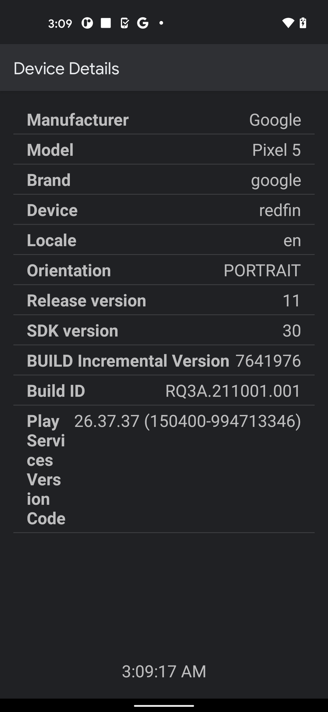
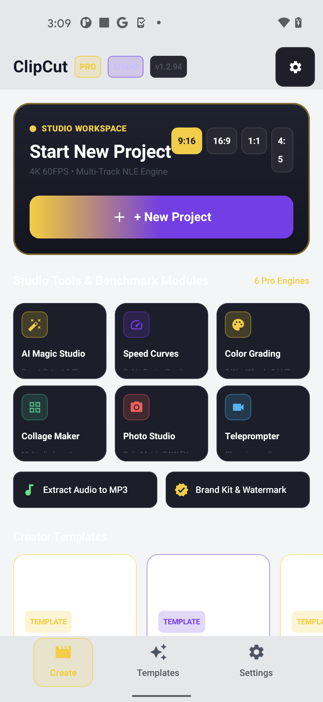
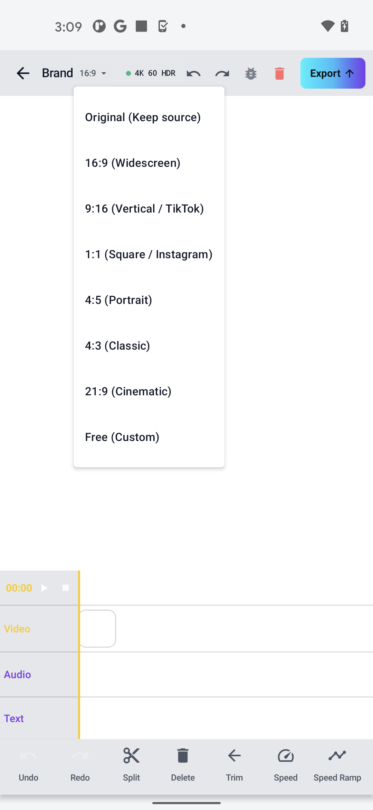
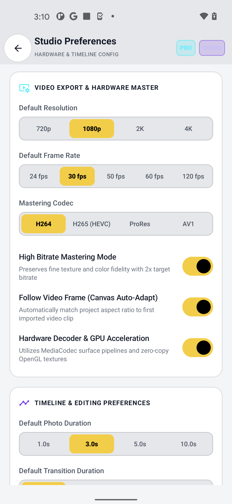
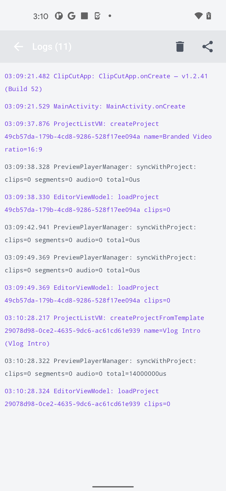
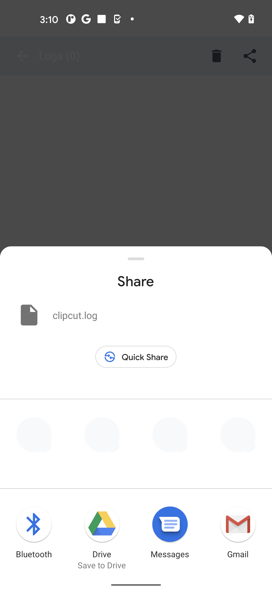
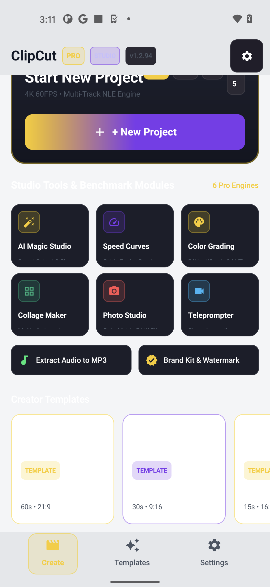
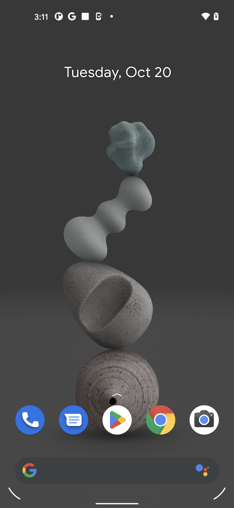

# ClipCut — Native Android Offline Video Editor

<div align="center">

-3DDC84?style=for-the-badge&logo=android&logoColor=white)


[](https://wa.me/923171616345?text=Hi%20letmese%2C%20I%20am%20interested%20in%20your%20ClipCut%20Android%20video%20editor.)

### *Professional, 100% On-Device Native Video Editor with Zero Network Dependency*

</div>

---

## 📖 Overview

**ClipCut** is a native, offline-first Android video editor engineered with **Kotlin**, **Jetpack Compose**, **MediaCodec**, and **OpenGL ES**. Designed for content creators, mobile journalists, and privacy-conscious users, ClipCut executes every aspect of decoding, filtering, audio mixing, and export locally on the device GPU/VPU without streaming data to cloud servers.

---

## 📱 App Preview (Live Firebase Test Lab Pixel 5 Screenshots)

<div align="center">
  
  
  
  
</div>

<div align="center">
  
  
  
  
</div>

---

- 🔒 **100% Offline & Private:** Zero account requirement, zero network telemetry, and no server-side rendering. Everything stays on the user's device.
- ⚡ **Zero-Copy Hardware Pipeline:** Surface-to-Surface hardware acceleration using Android's native `MediaCodec` and `MediaExtractor` / `MediaMuxer` pipeline for maximum export speed and thermal efficiency.
- 🎨 **OpenGL ES Shader Engine:** Real-time hardware filter pipeline featuring 3D LUT color grading, cinematic letterboxing, vignette, saturation/temperature curves, and Chroma Key virtual studio overlays.
- ⏱️ **Interactive Multi-Track Timeline:** Smooth, pinch-to-zoom interactive timeline supporting multi-segment video trimming, split, delete, speed ramping, and reordering.
- 📈 **Dynamic Curve Speed Control:** Precision speed adjustment (0.25x to 4x) featuring VN-style non-linear curve presets (*Flash, Hero, Bullet, Montage*).
- 🎙️ **Audio Mixing Studio:** Multi-channel audio mixer supporting background music insertion, custom sound effects, ducking, and original video track volume leveling.
- 📜 **Built-In Teleprompter & Overlay Text:** On-screen floating teleprompter studio with customizable scrolling speed and multi-font sticker overlays.
- 💾 **Local Project Persistence:** Lightweight Room database layer preserving complete project edit history, timeline states, and filter parameters across app restarts.

---

## 🛠️ Architecture & Core Components

```
ClipCut_Source/app/src/main/java/com/clipcut/
├── core/
│   ├── engine/           # GlFilter pipeline, OpenGL Shaders & Texture renderers
│   ├── player/           # ExoPlayer / Media3 preview playback manager
│   ├── export/           # MediaCodec hardware encoding and MP4 muxing engine
│   └── model/            # Timeline, speed curves, transitions & project entities
└── ui/
    ├── components/       # TimelineView, PlaybackControls, BottomSheets
    ├── screens/          # EditorScreen, CollageScreen, SettingsScreen
    ├── theme/            # Material 3 colors, typography, shapes
    └── viewmodel/        # EditorViewModel state holder & Coroutines scope
```

---

## 🚀 Building from Source

### Prerequisites
* Android Studio Ladybug (2024.2+) or newer
* Android SDK 34 / Build Tools
* JDK 17+

### Build Instructions
1. Clone the repository:
   ```bash
   git clone https://github.com/letmese/ClipCut.git
   cd ClipCut
   ```
2. Build the debug APK using the Gradle wrapper:
   ```bash
   ./gradlew assembleDebug
   ```
3. The APK will be generated at `app/build/outputs/apk/debug/`.

---

## 📦 Pre-Built Downloads

To install the latest tested Android APK (`ClipCut_v1.2.94_Build105.apk`), check the releases:
* **[GitHub Releases](https://github.com/letmese/ClipCut/releases)**

---

## 👨‍💻 Developer & Inquiries

Designed and developed by **letmese**.

* **GitHub Profile:** [@letmese](https://github.com/letmese)
* **Location:** Lahore, Pakistan (Available for mobile app contracts worldwide)
* **WhatsApp Direct:** [**+92 317 1616345**](https://wa.me/923171616345?text=Hi%20letmese%2C%20I%20am%20interested%20in%20your%20ClipCut%20Android%20video%20editor.)

---

## 📄 License

This project is licensed under the [MIT License](LICENSE).
